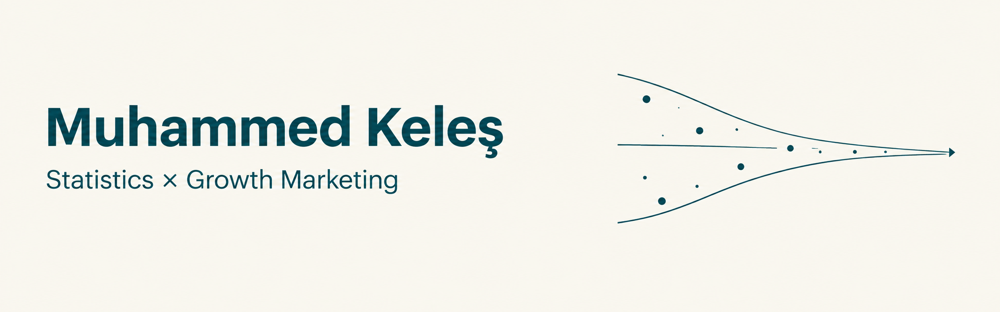

### Hi, I'm Muhammed

I'm a final-year Statistics student at Hacettepe University in Ankara. I'm interested in the questions growth and marketing teams ask (who to target, what a campaign actually changed, where a funnel leaks) and in answering them with proper statistics instead of dashboards alone.

**Projects**

- [**SalesSense**](https://github.com/mtahakeles/SalesSense) Why do Trendyol customers leave 1-2 star reviews? A topic tagger, category-level analysis and a text model on 580k Turkish reviews. The main complaint is different in every category.
- [**Cart recovery: who should get the discount?**](https://github.com/mtahakeles/cart-recovery-uplift) Uplift modelling on a simulated A/B test. Targeting by predicted uplift beats "send it to likely buyers", which loses money.
- [**Decision Decay**](https://github.com/mtahakeles/decision-decay) Do footballers pass worse late in games? Mixed-effects logistic regression on 56k World Cup passes says no: the raw drop comes from the pass mix. (Python + R)
- [**Habitat Sentinel**](https://github.com/mtahakeles/habitat-sentinel) Live NASA wildfire map plus a small risk model served in the browser. Hackathon project.

**Tools:** Python (pandas, scikit-learn, statsmodels), R (tidyverse, lme4), SQL, Excel, Power BI, SPSS

**Outside the classroom:** I interned in marketing at BlueSense (positioning and content for a mobile app), I run a few short-form video pages on Instagram, TikTok and YouTube, and I build marketing automations with n8n and ManyChat. That's where most of my questions come from.

📫 emuhammedkeles@gmail.com · [LinkedIn](https://www.linkedin.com/in/muhammed-keles)
